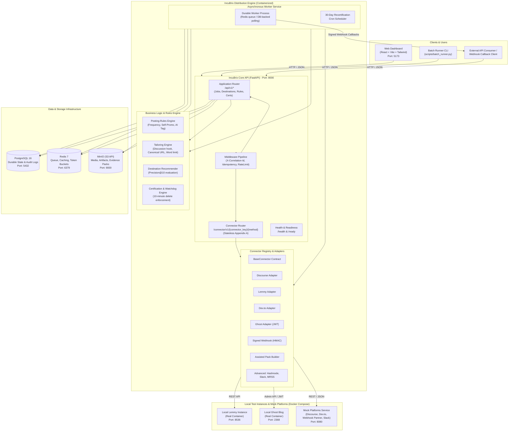
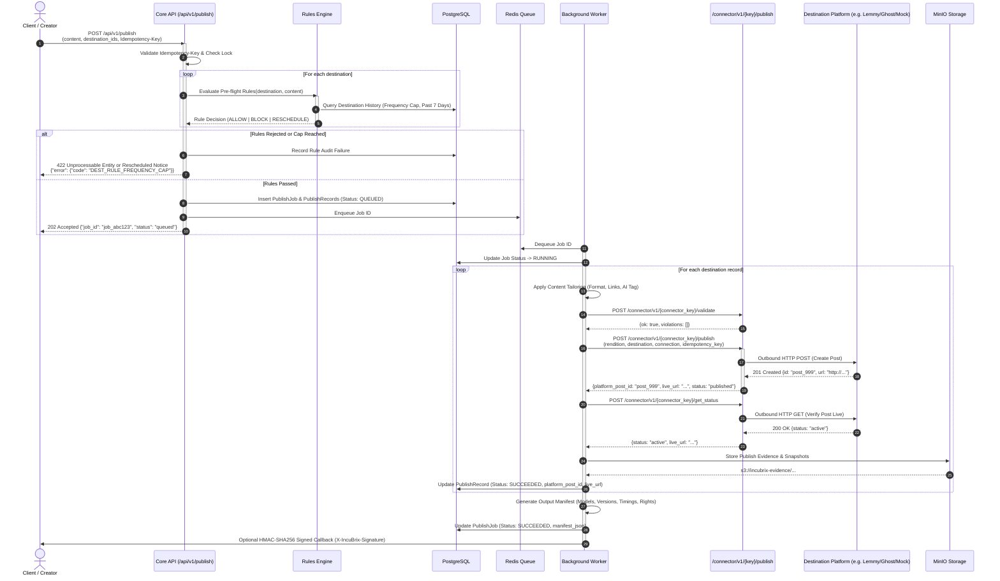
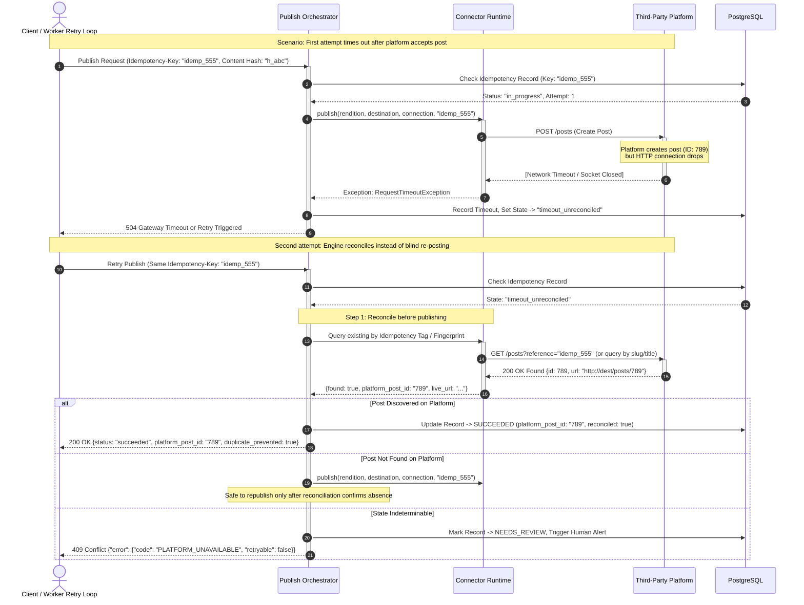
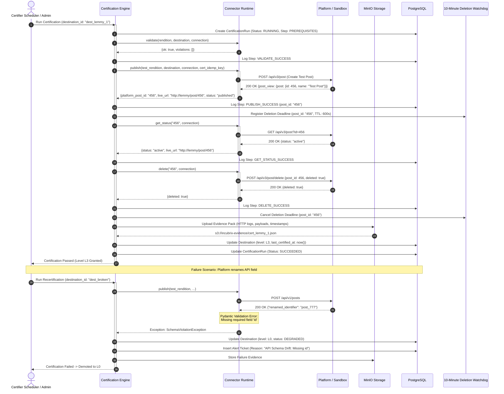
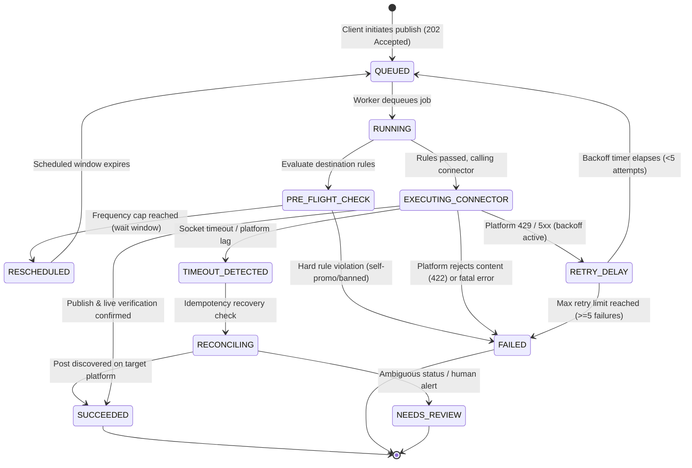
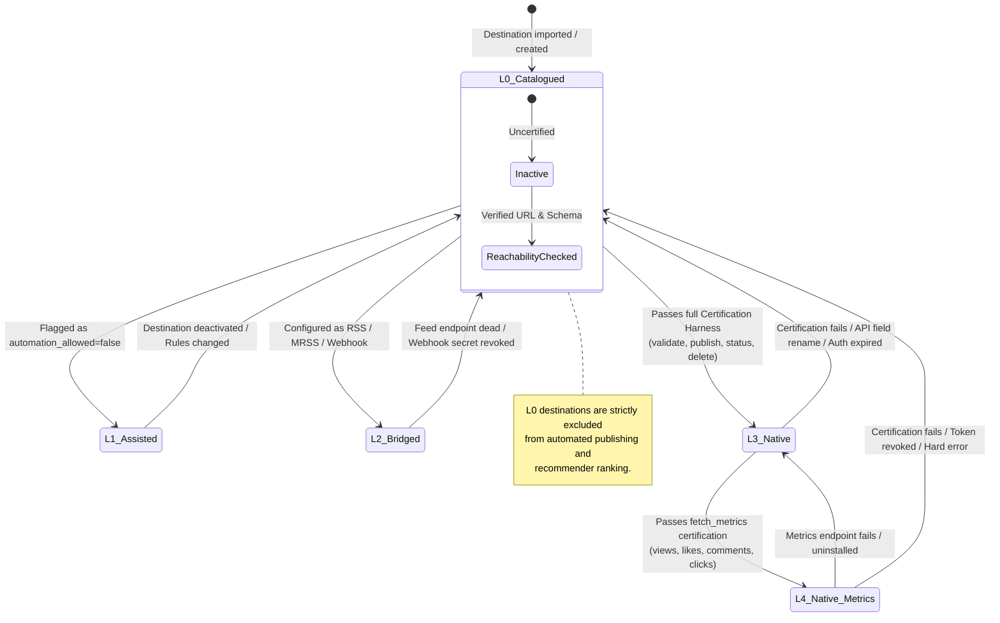
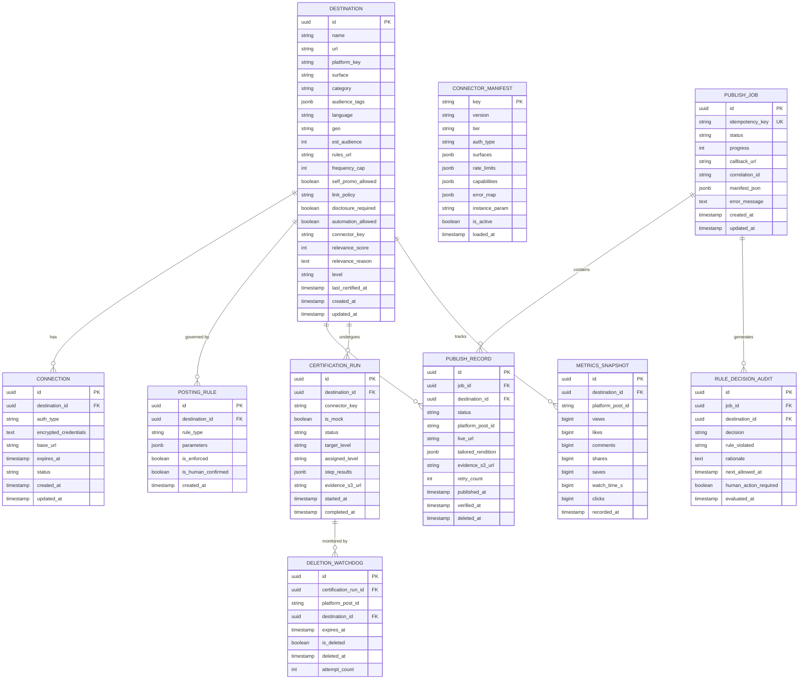

# IncuBrix Long-Tail Distribution Network: Architecture Specification

**Document**: System Architecture & Design Specification  
**Assessment**: IncuBrix Engineering Assessment 4  
**Date**: October 2026  
**Status**: Architecture Baseline  

---

## 1. Architectural Philosophy & Design Principles

The IncuBrix Long-Tail Distribution Network is engineered around five fundamental architectural tenets:

1. **Stateless Connectors, Stateful Runtime**:
   Per Appendix A of the IncuBrix specification, connectors are pure protocol translators. A connector method (`validate`, `publish`, `get_status`, `delete`, `fetch_metrics`, `refresh_auth`, `build_assist_pack`) accepts inputs, communicates over HTTP with the target platform, and returns structured result dictionaries. Connectors **never touch the IncuBrix database**. All state management, audit logging, rate limiting, and persistence are owned exclusively by the central runtime.
2. **One Connector, Many Destinations (Instance Parameterization)**:
   A connector defines the protocol adapter for a platform class (e.g., `discourse`, `lemmy`, `ghost`). Individual destinations (e.g., Discourse Forum A vs Forum B) are represented purely as configuration rows in the catalogue referencing `instance_param` (such as `base_url`). Scaling the long tail requires zero code modifications.
3. **Pre-flight Rules & Zero-Tolerance Safety**:
   No post touches a connector without passing through the deterministic Posting-Rules Engine. Frequency caps, link constraints, self-promotion rules, and mandatory AI-disclosure tags are checked before any network dispatch. Test posts are isolated to local sandboxes and guaranteed deleted within 10 minutes.
4. **Defensive Concurrency & Reconcile-Before-Republish**:
   Every state-altering request requires an `Idempotency-Key`. In the event of a platform timeout where post creation status is ambiguous, the engine reconciles by querying the platform prior to attempting any republish, eliminating duplicate posts.
5. **Fail-Closed Certification & Continuous Verification**:
   No destination is promoted to active publishing status (`L3` / `L4`) without passing an automated end-to-end certification cycle (publish -> verify live -> read status -> delete -> store evidence). Any API contract drift or breaking field rename triggers immediate demotion to `L0`.

---

## 2. System Context & Container Architecture (C4 Model)

The following diagram illustrates the system boundaries, runtime containers, data stores, local test sandboxes, and external integration points.



---

## 3. Sequence Diagrams

### 3.1 Publish Flow: End-to-End Orchestration
This sequence traces a content publication request from ingestion through tailoring, pre-flight rule validation, asynchronous worker execution, connector invocation, live status check, evidence capture, and manifest generation.



---

### 3.2 Idempotent Retry & Timeout Reconciliation
This sequence illustrates how the system handles a network timeout after a platform accepts a post, reconciling without creating a duplicate.



---

### 3.3 Certification Run & Automated Demotion
This sequence illustrates the end-to-end certification lifecycle: validation, live test post, status confirmation, mandatory 10-minute deletion, evidence packaging, level assignment, and automated demotion when API drift occurs.



---

## 4. State Diagrams

### 4.1 Job State Machine
Represents the lifecycle of asynchronous publishing operations managed by the job engine.



---

### 4.2 Destination Level Transitions (L0–L4)
Represents the trust and capability maturity levels defined in Appendix A and Page 9 of the specification.



---

## 5. Entity-Relationship (ER) Diagram

The relational data model implemented in PostgreSQL via SQLAlchemy 2 and managed with Alembic.



---

## 6. Security, Secrets Protection & Error Handling Architecture

### 6.1 Secrets Protection & Redaction Pipeline
1. **Zero Secret Persistence in Repos**:
   All tokens, API keys, and webhook signing secrets are injected purely via environment variables or loaded encrypted into PostgreSQL.
2. **Streaming Log Redaction**:
   The custom JSON logging formatter intercepts log records and matches against compiled regex patterns for API keys, bearer tokens, JWT signatures, and hex secrets (`Bearer [A-Za-z0-9_\-\.]+`, `Api-Key [A-Za-z0-9]+`, `whsec_[A-Za-z0-9]+`), replacing them with `[REDACTED]` prior to emission.
3. **Signed Webhooks & Signature Verification**:
   - Outbound partner webhooks are signed using HMAC-SHA256 (`X-IncuBrix-Signature`) calculated over `timestamp + "." + raw_body`, protecting against replay attacks via a 5-minute timestamp validity window.
   - Background job callback payloads use identical cryptographic signing.

### 6.2 Standardized Error Architecture
Every error across `/api/v1/` and `/connector/v1/` returns HTTP status codes mapped to the standardized error schema:

```json
{
  "error": {
    "code": "PLATFORM_RATE_LIMIT",
    "message": "Target community rate limit reached. Reset in 320 seconds.",
    "retryable": true,
    "details": {
      "reset_epoch": 1776543200,
      "retry_after_seconds": 320,
      "destination_id": "8a72b14e-0c9f-431e-b81b-53c842b10a22"
    }
  }
}
```

The error mapping engine enforces the following translation matrix across all connectors:
- HTTP 400 -> `DEST_SPEC_VIOLATION` (Retry: No)
- HTTP 401 / 403 -> `CONNECTION_AUTH_EXPIRED` (Retry: After Reconnect)
- HTTP 422 -> `PLATFORM_CONTENT_REJECTED` (Retry: No)
- HTTP 429 -> `PLATFORM_RATE_LIMIT` (Retry: Yes, after backoff)
- HTTP 500 / 502 / 503 / 504 -> `PLATFORM_UNAVAILABLE` (Retry: Yes, max 5 consecutive)
- Disabled Flag -> `CONNECTOR_DISABLED` (Retry: No)

---

## 7. Architecture Verification Summary
All sequence flows, state machines, and relational schemas directly fulfill the IncuBrix Assessment 4 brief and master prompt rules. The engine prioritizes reliability, rules verification, and idempotent recovery over cosmetic features.
